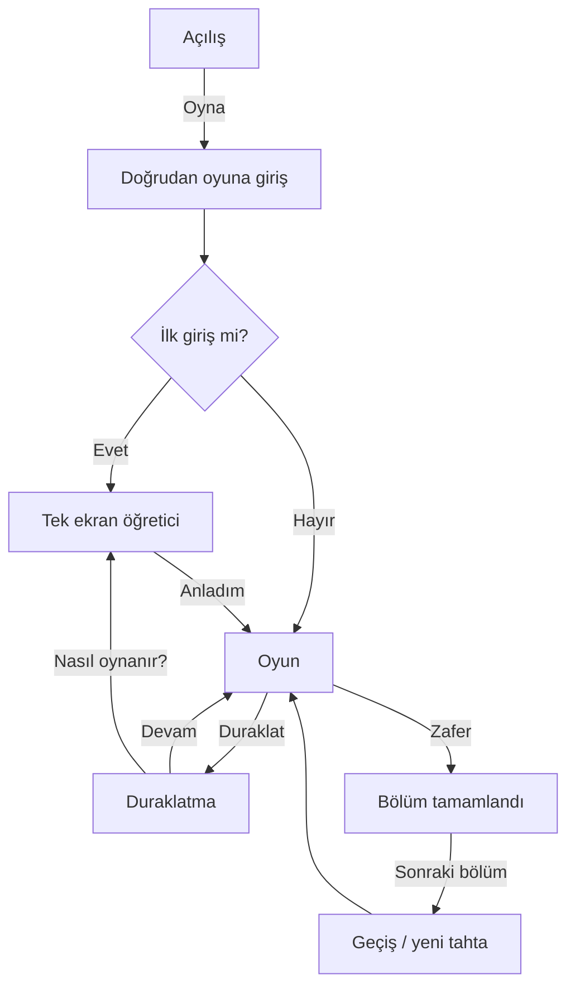

# SK-DESIGN-001 — Sabun Kaydırağı · İlk Tasarım Paketi

| Alan | Değer |
|------|--------|
| **Görev kimliği** | SK-DESIGN-001 |
| **Sürüm** | 0.1 |
| **Tarih** | 2026-11-05 (Europe/Istanbul, UTC+3) |
| **Ürün** | Sabun Kaydırağı (onaylı mobil bulmaca) |
| **Kapsam** | Görsel dil, oyuncu akışı, tek ekranlık öğretici, bölüm ekranı yerleşimi, önizleme UI, erişilebilirlik |
| **Doğrulama durumu** | **Taslak — doğrulanmamış.** Godot çıktısı yok; gerçek oyun derlemesi / oynanış doğrulaması bekleniyor. Figma dosyası bu pakette yok. |
| **Lisans / kaynak** | Metin ve diyagramlar bu paket için özgün üretilmiştir. Font: sistem UI yığını önerilir (aşağıda). Hazır stok görsel veya lisansı belirsiz font **seçilmemiştir**. İkon ve tahta varlıkları özgün vektör olarak üretilmelidir. |

---

## 1. Gerekçe

Sabun Kaydırağı’nın onaylı çekirdek mekaniği (kuruda en fazla iki kare, engelde erken durma, köpük izi, köpüğe ulaşınca uzama, tüm sabunların kendi renk giderlerinde eşzamanlı durmasıyla zafer) oyuncuya **önceden okunabilir** olmalıdır. Bu paket mekaniği veya ödül dengesini değiştirmez; mevcut kuralları ekranda görünür kılar:

- Seçili sabunun yön ve durak **önizlemesi**, kuru iki kare sınırı ile köpük uzatmasını hamleden önce gösterir.
- Gider–sabun eşleşmesi yalnızca renge değil; **desen + şekil** ile de kodlanır (renk körlüğü).
- İlk oturumda bölüm seçimi yoktur; doğrudan oyun + tek ekranlık kısa öğretici ile sürtünme düşürülür.

---

## 2. Onaylı mekanik özeti (değiştirilmez)

Kerim tarafından verilen kurallar (özet; kaynak: ürün açıklaması):

1. Sabun seçilir ve dört yönden birine kaydırılır.
2. Kuru zeminde en fazla **iki kare** gider.
3. Taş, tahta kenarı veya başka sabun yolu keserse **daha erken** durur.
4. Geçilen karelerde **köpük** kalır.
5. Sonraki hamlede bir sabun köpüğe ulaşırsa **daha uzağa** kayabilir.
6. Bütün sabunlar aynı anda kendi renklerindeki giderlerdeyse bölüm kazanılır.
7. Örnek strateji: pembe sabun önce yana kaydırılarak mavi sabuna köpüklü yol açabilir.

**Bu pakette değiştirilmeyenler:** hareket mesafesi kuralları, engel davranışı, zafer koşulu, ödül / ilerleme dengesi (tanımlı değilse dokunulmaz).

**Bu pakette eklenen (yalnızca sunum):** yön/durak önizlemesi, desen/şekil eşlemesi, UI yerleşimi, motion süreleri, reduced-motion alternatifleri.

---

## 3. Açık sorular (varsayım uydurulmaz)

| Kimlik | Konu | Not |
|--------|------|-----|
| AQ-01 | Hedef çözünürlük / güvenli alan | Cihaz sınıfı (ör. 360×640 dp, notch, gesture bar) onaylanmamış. Yerleşim **oran ve dp** ile tarif edilir; kesin px hedefi yok. |
| AQ-02 | Köpük bonusunun kesin değeri | “Daha uzağa” onaylı; ek kare sayısı / zincirleme / köpük tüketimi **bilinmiyor**. Önizleme “uzama bölgesi”ni görsel olarak ayırır; sayısal bonus **uydurulmaz**. |
| AQ-03 | Bölüm sayısı, yıldız, hamle limiti | Ödül dengesi kapsamında; bu pakette tanımlanmaz. |
| AQ-04 | Ses / haptik | Tasarım dışı bırakıldı; sonraki ses paketine. |
| AQ-05 | 5×5 örnek tahtanın çözülebilirliği | Aşağıdaki örnek **öğretici anlatım** içindir; çözülebilirlik **doğrulanmamıştır**. |

---

## 4. Oyuncu akışı (ilk sürüm)

Bölüm seçimi **yok**. Sıra:

1. **Açılış** — logo / başlık, “Oyna” birincil CTA.
2. **Doğrudan oyuna giriş** — son veya ilk uygun bölüme.
3. **Tek ekranlık kısa öğretici** — overlay; tek “Anladım” ile kapanır (tekrar: duraklat → “Nasıl oynanır?”).
4. **Oyun** — tahta, seçim, kaydırma, önizleme.
5. **Duraklatma** — devam / öğreticiyi aç / (varsa) ayarlar girişi; mekanik değişmez.
6. **Bölüm tamamlandı** — kısa kutlama, “Sonraki bölüm”.
7. **Sonraki bölüm geçişi** — tahta yenilenir; öğretici tekrar zorlanmaz.

### 4.1 Akış diyagramı



Aynı akış `SK-DESIGN-001-oyuncu-akisi.svg` dosyasındadır.

---

## 5. Tek ekranlık kısa öğretici (içerik)

Başlık: **Nasıl oynanır?**

Madde metinleri (kısa, Türkçe):

1. Bir sabun seç, istediğin yöne kaydır.
2. Kuru zeminde en fazla iki kare gidersin; taş, kenar veya başka sabun erken durdurur.
3. Geçtiğin karelerde köpük kalır; köpüğe ulaşırsan daha uzağa kayabilirsin.
4. Tüm sabunlar kendi renk (ve desen) giderlerindeyken bölüm biter.

Alt not (tek satır): *Seçili sabunda ok ve durak işaretleri gideceğin yolu önceden gösterir.*

CTA: **Anladım** (birincil, alt güvenli alanda).

---

## 6. Bölüm ekranı — dikey mobil yerleşim

Hedef: portre, tek elle oynanabilir. (AQ-01: kesin çözünürlük yok.)

```
┌─────────────────────────────┐
│  [II]  Bölüm N        [?]   │  ← üst çubuk ~48–56 dp
├─────────────────────────────┤
│                             │
│         OYUN TAHTASI        │  ← dikey ortada, kare grid
│         (max genişlik       │     yanlarda ≥16 dp margin
│          içerik alanı)      │
│                             │
├─────────────────────────────┤
│  Durum: seçili sabun ipucu  │  ← tek satır yardım ~40 dp
│  (isteğe bağlı, öğretici    │
│   sonrası sönük)            │
└─────────────────────────────┘
```

**Önerilen dikey oran (kabaca):** üst çubuk %10 · tahta %70–75 · alt yardım %10–15. Tahta hücreleri eşit kare; tahta ekran genişliğinin ~%88’ini aşmasın.

### 6.1 Tipografi (okunabilirlik)

Sistem font yığını (lisans net):

- **iOS:** SF Pro Text / Display (sistem)
- **Android:** Roboto / sistem varsayılanı
- **Genel CSS/UI yedek:** `system-ui, -apple-system, "Segoe UI", Roboto, "Helvetica Neue", Arial, sans-serif`

| Rol | Öneri (dp / sp) | Ağırlık |
|-----|------------------|---------|
| Açılış başlığı | 28–32 | Semibold |
| Bölüm tamamlandı başlığı | 22–24 | Semibold |
| Üst çubuk / bölüm no | 16–18 | Medium |
| Öğretici gövde | 15–16 | Regular; satır yüksekliği ≥1.35 |
| Yardım satırı | 13–14 | Regular |
| CTA düğme metni | 16–17 | Semibold |

Minimum gövde metin: **14 sp/dp**. Kontrast: metin/arka plan WCAG AA hedefi (≥4.5:1 gövde).

### 6.2 Örnek renk paleti

Nötr zemin + yüksek doygunlukta sabun renkleri. Hex örnek; marka kilidi yok.

| Token | Hex | Kullanım |
|-------|-----|----------|
| `bg.app` | `#F4F1EA` | Uygulama zemini (ılık krem) |
| `bg.board` | `#E7E0D4` | Tahta zemini |
| `tile.dry` | `#D9D0C1` | Kuru kare |
| `foam` | `#B8E4F2` + beyaz nokta deseni | Köpük |
| `stone` | `#6B6560` | Taş engel |
| `ink` | `#1C1A17` | Metin |
| `soap.pink` | `#E85D8E` | Pembe sabun |
| `soap.blue` | `#3A7BD5` | Mavi sabun |
| `soap.green` | `#2FA86A` | (ileride) yeşil |
| `soap.yellow` | `#E0A800` | (ileride) sarı — ink üzerinde AA kontrolü |
| `cta` | `#1C1A17` | Birincil düğme zemin; metin `#F4F1EA` |
| `preview.path` | `%30 ink` overlay | Önizleme yolu |
| `preview.stop` | `#1C1A17` halka | Durak işareti |
| `preview.extend` | `#5BC0DE` kesik çizgi | Köpük uzama bölgesi (sayısal iddia yok) |

### 6.3 Renk körlüğü — sabun ↔ gider desen / şekil

Renk **tek kanal olmaz**. Her sabun–gider çifti aynı **şekil silüeti + iç desen** taşır; gider doğru sabunla dolduğunda hem renk hem desen/şekil hizalanır.

| Kimlik | Renk | Şekil (üstten) | İç desen | Gider göstergesi |
|--------|------|----------------|----------|------------------|
| Pembe | `#E85D8E` | Yuvarlak / hap | Dikey çizgiler | Yuvarlak ağız + dikey çizgi halkası |
| Mavi | `#3A7BD5` | Kare (hafif yuvarlatılmış) | Yatay çizgiler | Kare ağız + yatay çizgi halkası |
| Yeşil | `#2FA86A` | Üçgen (yumuşak) | Nokta ızgara | Üçgen ağız + nokta halkası |
| Sarı | `#E0A800` | Altıgen | Çapraz çizgiler | Altıgen ağız + çapraz halkası |

**Dolu gider:** sabun giderin içine oturur; kenarda ince **eşleşen desen halkası** + kısa onay (✓ veya şekil kilit) — yalnızca görsel geri bildirim.

### 6.4 Dokunma hedefleri

| Öğe | Minimum |
|-----|---------|
| Sabun hücresi / seçim | ≥44×44 dp; mümkünse hücre boyutu |
| Üst çubuk ikonları (duraklat, yardım) | ≥44×44 dp dokunma alanı; görsel ikon ~24 dp |
| CTA düğmeleri | yükseklik ≥48 dp, yatay padding ≥24 dp |
| Kaydırma jesti | seçim sonrası ≥16 dp hareket eşiği; yanlışlıkla tetiklemeyi azalt |

### 6.5 İkon kuralları

- **Özgün vektör** (SVG/PDF); stok ikon seti veya belirsiz lisanslı asset yok.
- Çizgi kalınlığı tutarlı (~2 dp @1x mantığı); köşeler yuvarlak.
- Anlamlar: `II` duraklat · `?` öğretici · yön okları önizlemede · taş dolu blok silüet.
- Dekoratif gölge en fazla tek katman; okunabilirlik öncelikli.

---

## 7. Yön ve durak önizlemesi (mekanik değişikliği değil)

**Amaç:** Oyuncu, kuru iki kare sınırını ve köpük uzamasını **hamleden önce** görsün.

**Davranış:**

1. Sabun seçilince dört yöne **soluk ok** (geçerliyse).
2. Bir yön vurgulanınca (parmak sürükleme veya yön tap):  
   - **Kesin yol** (mevcut kurallara göre gideceği kareler) dolu yarı saydam şerit.  
   - **Durak karesi** kalın halka / “dur” işareti.  
   - Köpük üzerinden uzayacak kısım (AQ-02 bilinmiyorsa) **kesik çizgi / farklı ton** ile “uzama bölgesi” olarak ayrılır; üzerine sayı yazılmaz.
3. Engel (taş, kenar, sabun) yolun bittiği yerde durak gösterilir — erken durma görünür.
4. Bırakınca sabun animasyonla o yola kayar; önizleme kaybolur.

Bu katman kuralları uygulamaz; motorun hesapladığı yolu **görselleştirir**.

---

## 8. Hareket süreleri ve amaçları

| Animasyon | Süre (öneri) | Amaç |
|-----------|--------------|------|
| Sabun seçim vurgusu | 120–150 ms | Hangi taşın aktif olduğu |
| Önizleme yolu belirme | 100–180 ms | Yön netliği |
| Kayma (hücre başına) | 140–180 ms | Okunabilir hareket; toplam süre hücre sayısına göre |
| Köpük bırakma | kayma ile senkron, 80–120 ms fade-in | İz oluşumu |
| Gider dolum / eşleşme | 200–250 ms | Zafer parçası geri bildirimi |
| Bölüm tamamlandı panel | 220–300 ms ease-out | Kutlama, abartısız |
| Ekran geçişi (sonraki bölüm) | 250–350 ms | Tahta değişimi |

### 8.1 Reduced motion

Sistem `prefers-reduced-motion` / OS erişilebilirlik ayarı açıksa:

- Kayma → anında veya ≤80 ms kesme (crossfade pozisyon).
- Köpük → anında görünür; parçacık yok.
- Paneller → opacity crossfade ≤120 ms veya anında.
- Önizleme → animasyonsuz çizim.
- Zafer → kısa statik onay; sarsıntı / bounce yok.

---

## 9. Örnek 5×5 anlatım (doğrulanmamış çözülebilirlik)

Aşağıdaki tahta **öğretici senaryo** içindir. Pembe → mavi hamle sırası köpük yolunu anlatır. **Çözülebilirlik iddiası doğrulanmamıştır** (AQ-05).

Gösterim (üstten bakış; `P` pembe, `M` mavi, `#` taş, `p`/`m` ilgili gider, `.` kuru):

```
    1 2 3 4 5
  1 . . # . m
  2 . P . . .
  3 . . . . .
  4 . . M . .
  5 p . # . .
```

**Anlatılan akış (örnek):**

1. Oyuncu **P**’yi seçer; sağa önizleme: kuruda en fazla iki kare → örn. satır, sütun (2,2)→(2,3)→(2,4); durak (2,4).  
2. Pembe sağa kayar; geçilen karelerde köpük kalır.  
3. Oyuncu **M**’yi seçer; yukarı önizleme: önce kuru/köpük kurallarına göre yol; pembe’nin bıraktığı köpüğe ulaşırsa **uzama bölgesi** kesik çizgiyle gösterilir (mesafe AQ-02). Böylece mavi, yalnız kuru iki kareyle ulaşamayacağı bir hedefe yaklaşabilir.  
4. Zafer için hem P hem M kendi giderlerinde (`p`, `m`) **aynı anda** olmalıdır — bu örnekte tam çözüm yolu iddia edilmez.

---

## 10. Ekranlar — kısa UI notları

### Açılış
- Ortalı başlık “Sabun Kaydırağı”, altta birincil **Oyna**.
- İkincil link yok zorunlu değil (ayarlar sonraya).

### Duraklatma
- Yarı saydam perde + kart: **Devam**, **Nasıl oynanır?**, (opsiyonel) ses — mekanik yok.

### Bölüm tamamlandı
- “Bölüm tamam!” + **Sonraki bölüm**.
- Yıldız / skor **yok** (ödül dengesi tanımlı değil; eklenmez).

---

## 11. Kabul ölçütleri

1. Belge SK-DESIGN-001, sürüm 0.1; Türkçe; gerekçe, açık sorular, lisans/kaynak, doğrulama durumu içerir.  
2. Onaylı mekanik ve (tanımsız) ödül dengesi **değiştirilmemiştir**.  
3. AQ-01 ve AQ-02 için sayısal varsayım **yok**; açık soru olarak yazılı.  
4. Akış: açılış → doğrudan oyun → tek ekran öğretici → oyun → duraklat → tamamlandı → sonraki bölüm.  
5. Dikey yerleşim, tipografi, palet, desen/şekil eşlemesi, dokunma, ikon, motion + reduced motion tariflidir.  
6. Önizleme, kuru iki kare ve köpük uzamasını görünür kılar; kural eklemez.  
7. Gider dolumu renk + desen/şekil ile gösterilir.  
8. 5×5 örnek pembe-sonra-mavi anlatır; çözülebilirlik doğrulanmamış işaretlidir.  
9. Font: sistem; görseller: özgün vektör önerisi; belirsiz lisanslı asset yok.  
10. Godot çıktısı olmadığını ve gerçek oyun doğrulamasının beklediğini belirtir.  
11. Paket `docs/design/SK-DESIGN-001/v0.1/` altındadır ve sürüm manifesti ile kayıtlıdır.

---

## 12. Teslim ve sınırlar

| Madde | Durum |
|-------|--------|
| `SK-DESIGN-001.md` | Bu dosya |
| `SK-DESIGN-001-oyuncu-akisi.svg` | Oyuncu akış diyagramı |
| Oyuncu akış diyagramı | Bölüm 4.1 (Mermaid) ve SVG dosyası |
| Godot / çalışır build | **Yok** — bekleniyor |
| Figma | Yok. Bu aşamada üretilmedi. |
| Oynanış QA | **Bekliyor** |

---

## 13. Önemli tasarım kararları (özet)

1. Bölüm seçimi ertelendi; ilk sürüm sürtünmeyi azaltmak için doğrudan oyun.  
2. Önizleme = kuralın aynası; bonus mesafesi uydurulmadı.  
3. Renk + şekil + desen üçlüsü ile renk körlüğü desteği.  
4. Sistem fontu + özgün vektör; lisans riski taşınmadı.  
5. Reduced motion zorunlu alternatif olarak yazıldı.  
6. Örnek 5×5 didaktik; çözülebilirlik doğrulanmadı.

---

*SK-DESIGN-001 · v0.1 · doğrulanmamış taslak · 2026-11-05 Europe/Istanbul*
